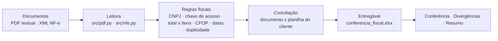

# Fiscal Document Automation

[](https://github.com/nerdylog-code/fiscal-document-automation/actions/workflows/ci.yml)
[](LICENSE)

Automação de **conferência fiscal documental**: lê os documentos que chegam (PDF textual de DANFE e XML de
NF-e), aplica as regras fiscais de verdade, concilia com a planilha que a área usa hoje e devolve **uma
planilha de conferência pronta** — com a lista de divergências e o resumo do lote.

> **Resultado em produção real:** este fluxo de trabalho (leitura + conferência + planilha estruturada) foi
> aplicado em um processo fiscal real que consumia **mais de uma semana de três pessoas** e passou a ser
> concluído em **aproximadamente uma hora**. Detalhes do ambiente, da empresa e dos dados **não são
> divulgados**. Este repositório é a versão *clean-room*: dados sintéticos, nenhuma informação de cliente,
> nenhuma regra proprietária — e **não** é o software corporativo.

## O problema (e por que ele custa caro)

Conferência fiscal manual, documento a documento, tem sempre o mesmo formato de dor:

- alguém abre o documento e digita os campos em uma planilha;
- erro de digitação só aparece no fechamento, quando corrigir já custou retrabalho;
- documento faltando ou em duplicidade na planilha aparece tarde;
- não existe medida de quanto tempo isso consome — então melhoria vira opinião.

O que dá para automatizar é exatamente o que este repositório faz.

## Como funciona



| Etapa | Arquivo | O que resolve |
|---|---|---|
| Leitura | `src/pdf.py`, `src/nfe.py` | PDF textual e XML de NF-e → campos normalizados |
| Regras fiscais | `src/rules.py` | dígito verificador de CNPJ, **DV da chave de acesso** e coerência interna dela (UF, AAMM, CNPJ, modelo, série, número), total contra soma dos itens (tolerância de 2 centavos), CFOP compatível com a operação, vencimento antes da emissão, duplicidade no lote |
| Conciliação | `src/reconcile.py` | valor, CNPJ e vencimento entre documento e planilha; linhas sobrando e faltando nos dois lados |
| Entregável | `src/xlsx.py`, `src/pipeline.py` | planilha com 3 abas (Conferência, Divergências, Resumo) escrita **sem biblioteca externa** |
| Medição | `src/pipeline.py` | tempo real do lote + taxa de aprovação automática, separando o que é medido do que é parâmetro |

Status possíveis por documento: `aprovado_automatico`, `divergencia`, `revisao_documento`, `duplicado`,
`ausente_na_planilha`, `ausente_nos_documentos`.

## Resultado da última execução (60 documentos sintéticos)

| Indicador | Valor |
|---|---|
| Documentos no lote | 60 (15 em PDF, 45 em XML) |
| Linhas na planilha do cliente | 61 |
| Aprovados automaticamente | **48 (77%)** |
| Divergências documento × planilha | 5 (3 valor, 1 CNPJ, 1 vencimento) |
| Documentos que violam regra fiscal | 4 (chave inválida, CNPJ inválido, total ≠ itens, CFOP incompatível) |
| Duplicidade | 1 |
| Ausentes (cada lado) | 2 na planilha · 2 sem documento |
| Tempo do lote | 0,01 s (medido; `output/desempenho.json`) |
| Conferência manual equivalente | 12 h (parâmetro declarado de 12 min/documento) |

As divergências não são surpresa: elas são **injetadas de forma declarada** em `src/make_fixtures.py`
(dicionário `DIVERGENCES`) e há teste que exige que o pipeline encontre todas — inclusive o documento que
passa só porque o erro é de 2 centavos (tolerância) e o que falha com 3 centavos.

## Como rodar

Requisito único: **Python 3.11+**. Nada de `pip install` — o núcleo usa só a biblioteca padrão
(`zlib`, `zipfile`, `ElementTree`, `decimal`, `hashlib`), o que importa quando o destino é a máquina de
usuário final, muitas vezes sem permissão de instalar nada.

```bash
make all      # gera os fixtures sintéticos e roda o pipeline completo
make test     # 48 testes
make check    # confere os 47 artefatos contra o baseline versionado
make repro    # roda 2x e compara o hash da planilha (precisa ser igual)
```

No Windows, na máquina do usuário:

```bat
py -3 -m src.pipeline
start output\conferencia_fiscal.xlsx
```

Para virar rotina diária, o Agendador de Tarefas (Windows) ou o `cron` (Linux) chama
`py -3 -m src.pipeline --fixtures "C:\documentos\dia"` e o resultado aparece na planilha de conferência —
nenhuma etapa depende de alguém digitar campo.

## O que este repositório prova

- **Regra fiscal implementada, não decorada**: o dígito verificador da chave de acesso (módulo 11 com pesos
  cíclicos 2–9) e o DV de CNPJ são calculados e conferidos contra valores conhecidos nos testes; a chave
  ainda é validada contra o resto do documento (CNPJ, número, modelo, UF).
- **Dinheiro em `Decimal`**, com tolerância explícita de 2 centavos — não em `float`.
- **Achado o que foi injetado**: 12 divergências declaradas, 12 encontradas (teste de ponta a ponta).
- **Entregável reprodutível**: mesma seed ⇒ planilha byte a byte idêntica (por isso o tempo medido fica em
  arquivo separado, fora do que é versionado).
- **Entrada tolerante**: a planilha do cliente pode ter as colunas com o nome que ele quiser
  (`valor`, `valor_total`, `total`; `chave`, `chave_acesso`) — o adaptador de colunas está em
  `src/pipeline.py::spreadsheet_rows`.

## Limites (o que este projeto NÃO é)

- **Dados sintéticos**: CNPJs e chaves de acesso são gerados com DV calculado; nenhum documento, cliente ou
  valor real. Fontes, empresa e regras proprietárias do processo original não estão aqui.
- **PDF textual apenas**: extrai texto de PDFs com o texto no fluxo de conteúdo (o formato que ERP emite).
  PDF escaneado exige OCR; layouts complexos pedem `pypdf`/`pdfplumber` — o único ponto a trocar é
  `src/pdf.py::read_pdf`.
- **Sem integração com SEFAZ** e **sem apuração de imposto**: não consulta status de NF-e, não calcula ICMS/PIS/COFINS,
  não transmite evento. É conferência documental, não escrituração.
- **Sem autenticação/web**: roda como processo local sobre uma pasta, que é exatamente o cenário da área.
- Tolerância, CFOPs aceitos e o parâmetro de 12 min/documento estão **explícitos e configuráveis** — a
  estimativa de economia é declaração explícita (com faixa de sensibilidade), não resultado medido de cliente.
